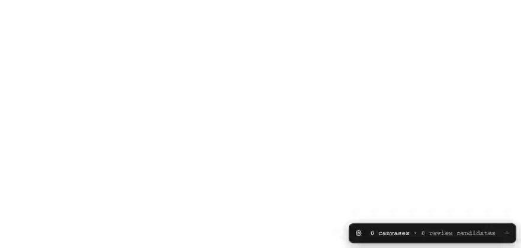

# canvas-scan

Find wasted canvas redraws in React apps.

canvas-scan is a drop-in dev tool for canvas-heavy React apps. One early
import instruments every observable main-thread Canvas2D canvas on the page.
For each canvas, the tool reports the nearest React owner, draw-batch counts,
canvas API self-time, and a frame-over-frame command-signature comparison.
When a canvas repeats the previous window's command signature, the overlay
flashes a red outline with the owner's name.



## Status

Pre-release. The package is not on npm yet. The core is tested against
react-konva and chart.js on real library internals — see
[packages/dogfood/FINDINGS.md](packages/dogfood/FINDINGS.md).

## What the tool measures

The tool does not claim pixel identity, repaint cost, or commit causality.
The wrapping mechanism cannot measure those. The tool reports only what it
can prove:

- `signatureStatus` — `same | changed | unknown`. The tool hashes the
  captured command stream per animation-frame window and compares it with
  the previous captured window. `same` means the canvas received identical
  commands. Identical commands do not prove identical pixels.
- `unknownReason` — the input that made a window unprovable. Examples:
  `HTMLVideoElement`, `Path2D:dirty`, `canvas-resize`, `first-window`.
- `nearestReactOwner` and `attributionKind` — the owning component, with an
  explicit confidence level: `jsx-owner | direct-host | container-only |
  unattributed`. The owner walk skips library wrappers and minified
  internals, and never turns a named owner into null.
- `canvasApiSelfTimeMs` — synchronous time inside canvas API calls. This is
  enqueue cost, not GPU raster cost.
- `rasterOperationCount` — the number of operations that can change pixels
  in the window.

Path2D and CanvasGradient objects do not poison the signature. The tool
hashes their construction commands and treats each object as a stable token.
A mutated or untracked object still reports `unknown`.

## Install (from source)

The package is not published yet. Use one of these paths:

**Script tag.** Build the IIFE bundle, then load it before any other script:

```bash
pnpm --filter canvas-scan exec esbuild src/auto.ts --bundle --format=iife --outfile=dist/canvas-scan.iife.js --minify
```

```html
<script src="/canvas-scan.iife.js"></script>
```

**Workspace import.** Add the package to a pnpm workspace, then make it the
first import of your entry module:

```ts
import 'canvas-scan/auto';
```

The import order is load-bearing. React reads the devtools hook when it
loads, so canvas-scan must load first.

**Options.** Call `start()` yourself instead of the auto entry:

```ts
import { start } from 'canvas-scan';

start({
  captureEvery: 1,          // capture every animation-frame window
  overlay: true,            // red outlines + HUD (default true)
  skipOwners: ['MyWrapper'] // extra names for the attribution skip-list
});
```

`window.__CANVAS_SCAN__.getReports()` returns the latest report per canvas.

## Report shape

```ts
{
  canvasId: string;
  nearestReactOwner: string | null;
  attributionKind: 'jsx-owner' | 'direct-host' | 'container-only' | 'unattributed';
  sourceLocation: null;              // reserved
  rasterOperationCount: number;
  canvasApiSelfTimeMs: number;
  signatureStatus: 'same' | 'changed' | 'unknown';
  unknownReason: string | null;
  sampled: boolean;
  comparisonGap: number | null;      // windows since the compared capture
}
```

## How it works

canvas-scan installs the React devtools hook contract (via
[bippy](https://bippy.dev)) before React loads, and patches
`HTMLCanvasElement.prototype.getContext` so every 2D context is observed.
Prototype method wrappers count and hash each draw call. The tool's own
`requestAnimationFrame` tick snapshots the counters once per frame window.
No Proxy wraps the context: repeated `getContext('2d')` calls return the
identical native object, and native errors propagate unchanged. An internal
error trips a kill switch that turns all wrappers into passthroughs.

The overlay is DOM-only inside a shadow root. It contains no canvas element,
so the tool cannot instrument itself.

## Limits

- React component names require development or profiling builds.
- StrictMode double-fires effects in development. The tool records the
  physical draws it observes.
- OffscreenCanvas transfers and worker-owned canvases are not observable.
- CanvasPattern arguments poison the window to `unknown`.
- Measured overhead is ~0.3µs per captured operation. A 1,000-op frame pays
  ~0.23ms.

## License

MIT
